# @liminal-hq/jax

<p align="center">
  
</p>

<p align="center">
  <a href="https://www.npmjs.com/package/@liminal-hq/jax"></a>
  
  
  
  
  
</p>

Jax 🦦 is the Liminal HQ companion: a small 3D otter holding a book. He reacts to what an app is doing with calm, spring-smoothed moods, and falls back to a simple SVG otter when WebGL is unavailable. He is always optional and never takes focus.

> **Status:** early development. See `AGENTS.md` for the layout and `src/types.ts` for the contract.

## Usage

Install the package with `bun add @liminal-hq/jax three` — `three` is a peer dependency (version 0.160 or newer, tested with 0.160 and 0.186), so your app brings its own copy. With npm, use `npm install @liminal-hq/jax three`.

```ts
import { createJax } from '@liminal-hq/jax';

const jax = await createJax(document.getElementById('jax')!, { size: 160 });
jax.setMood('writing');
```

`createJax(host, options)` adds a canvas to `host` and returns a running companion. It rejects with `JaxUnavailableError` when WebGL is missing, so catch that and show the fallback.

There are twelve moods: `chill`, `flipping`, `writing`, `checking`, `fishing`, `tea`, `wave`, `thumbsup`, `stuck`, `printing`, `party` and `nap`.

`setMood(mood)` holds a mood until you set another. The one-shot moods (`wave`, `thumbsup`, `stuck` and `party`) play once and then hand back. With nothing going on, he drifts between `chill`, `flipping`, `fishing` and `tea`, and naps after a long quiet; pass `autoIdle: false` to switch that off.

`pet()` gives a friendly wave without changing the held mood, and `dispose()` stops the loop, frees the GPU and removes the canvas. Calling it twice is safe.

Pass a `skin` to dress him differently — start from `defaultSkin` and change its colours, lights or allowed props. Pass `patterns` to replace the motion for any mood: each is an `AnimationPattern` whose `target` returns the pose channels for a moment in time, and the engine springs and crossfades them for you. `createMotion`, `createMoodMachine` and `defaultPatterns` are exported if you want to drive the motion yourself.

Two looks are options on the skin. `cheeks` shows his rosy cheeks and is `false` by default. `hat` is `'none'` (the default), `'peakCap'`, `'topHat'` or `'party'`, with its colours for the caps in `colours.hat` and `colours.hatBand`. The party mood brings its own paper hat, which takes priority over a cap or top hat while it shows, and the chosen hat returns afterwards; choose `'party'` and the paper hat stays on in every mood, never doubled. The SVG fallback follows both options when you pass the same `skin`.

He follows the system reduced-motion setting and holds a still pose, and `setReducedMotion(on)` or the `reducedMotion` option overrides it. He also pauses whenever he is off screen or the tab is hidden.

When WebGL is unavailable, use the SVG companion from the `/fallback` entry, which does not import `three`:

```ts
import { createJax, JaxUnavailableError } from '@liminal-hq/jax';
import { createFallbackJax } from '@liminal-hq/jax/fallback';

const host = document.getElementById('jax')!;
const jax = await createJax(host).catch((error) => {
  if (error instanceof JaxUnavailableError) return createFallbackJax(host);
  throw error;
});
```

Run `bun run demo` for a page with every mood, two skins, cheeks and hat switches and a smoothness readout.

## Licence

Dual-licensed under Apache-2.0 or MIT. See `LICENSE-APACHE` and `LICENSE-MIT`.
